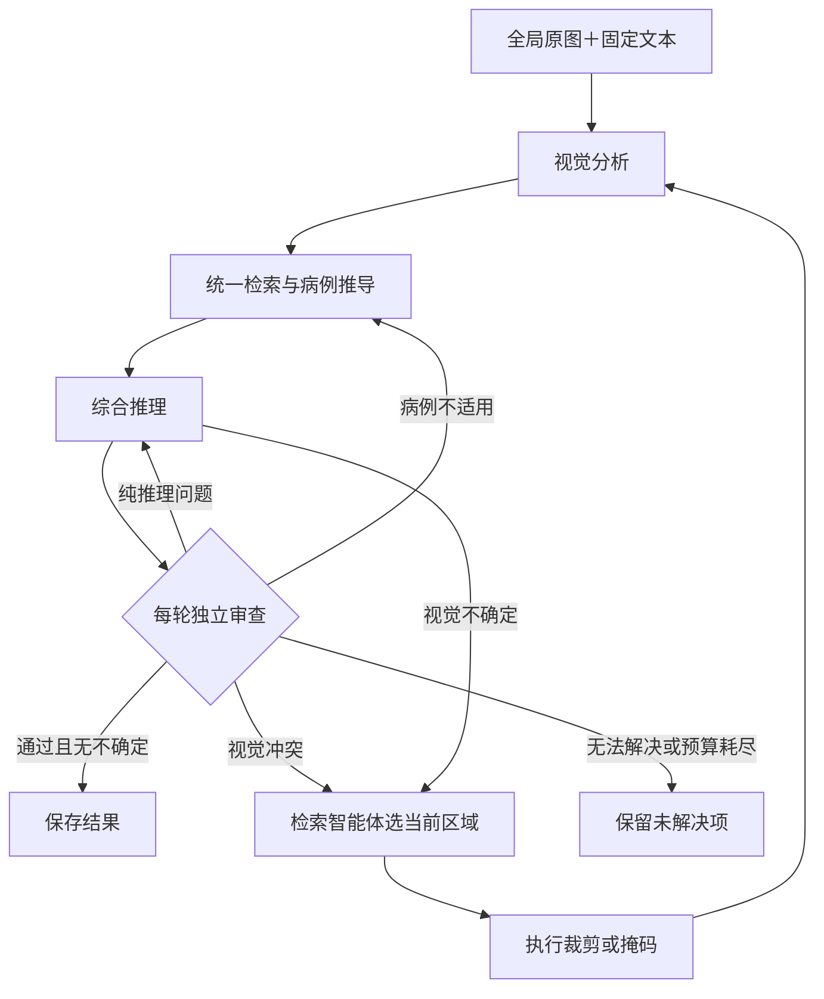

# 图片与文本的离线训练、测试

当前任务是：给定病例原图和允许的患者文本，预测病因与治疗方案；如果存在可用图像复查的不确定点，再看原图及一个裁剪/遮挡片段，更新判断。患者交流、患者画像、模拟患者、医生复核网页和旧 Node/SDK 批处理均已移除。

## 固定输入与隐藏标签

| 项目 | history 模式 | clinical 模式 |
| --- | --- | --- |
| 原图 | 本病例全部原图 | 本病例全部原图 |
| 既往史 | 输入 | 输入 |
| 分布、质地、色调、均一性 | 不从表格输入，可从图片形成视觉观察 | 输入 |
| 病因（含该单元格内的专业分级） | 隐藏标签 | 隐藏标签 |
| 治疗方案 | 隐藏标签 | 隐藏标签 |
| 边界及其他列 | 不输入 | 不输入 |
| 编号 | 只作图片/病例映射 | 只作图片/病例映射 |

表头括号中的说明不会成为新的字段。输入使用白名单，不采用“除最后一列外整行输入”。推理函数会拒绝带 `labels` 或错误文本字段的病例对象。整个病例循环中患者文本固定，不能通过后续轮次补入隐藏列。

当前表格中有 53 个病因和治疗均有标注的病例；默认 seed=42，42 个训练、11 个测试。只有编号或缺标签的行记录在 `split.json` 的排除清单中。`44-1.JPG` 和 `44-2.JPG` 同属一个病例；相同图像的病例分在同一个集合，缺图、重复编号等数据问题直接报错。

## 智能体职责与统一记忆

四个角色分别调用模型，有独立提示词、上下文和严格 JSON 契约；默认共用配置的同一个视觉模型 API。角色边界在 `agents.py` 校验，状态机在 `vision_loop.py` 执行。

| 角色 | 接收 | 负责输出 |
| --- | --- | --- |
| 视觉智能体 `visual` | 全部当前原图、固定患者文本、本轮辅助图、上次视觉结果和核查问题 | 带图像来源和可选区域的可见表征、新增证据、冲突、视觉不确定和质量局限；不输出病因/治疗 |
| 检索智能体 `retrieval` | 当前原图/辅助图、固定文本、最新视觉分析、推理缺口、审查反馈、同一记忆池的候选及可用历史图 | 病例相关性与适用性、原始证据引用、病例推导；需要复查时提出当前原图的裁剪/掩码方案 |
| 推理智能体 `reasoning` | 全部当前原图/本轮辅助图、固定文本、视觉分析、相关病例推导、上轮审查 | 病因、治疗、带来源的精炼依据、局限、分类不确定项和置信度；不选坐标、不评分记忆 |
| 审查智能体 `review` | 当前原图/辅助图、固定文本、视觉分析、病例推导、本轮推理 | 每轮检查图文、局部/全局、病例适用性和推理一致性；通过、视觉复查、重新检索、纯推理修正或未解决 |

每次需要病例时，都调用同一个 `OfflineMemory.retrieve()`：将固定文本、最新视觉表征、本轮缺口一起交给 `retrieval.unified()`。它复用原生表征匹配、患者经历文本匹配和衰退分，统一选出最多 `--top-k` 条候选。召回不以既往治疗标签作为患者经历；当前病例和相同图像病例排除。不存在“视觉阶段只按既往史、诊断阶段才加入表征”的固定分流。旧存储接口的分阶段函数仅为兼容保留，不在本批处理执行链中。

检索模型对每个候选给出临时相关性 `M`，按 `M × decay` 排列病例上下文。每条上下文保留版本、原始证据、各历史区域对应的视觉判断、标签、来源，并补充相同点、不同点、适用范围及“历史证据→既往标签→当前差异→可用范围”的摘要。原始医生推导缺失时明确为未知，模型推导标记 `model_inference`，不冒充医生记录。来源不存在、证据原文不在候选中或病例 ID 虚构会报错。

没有匹配病例时，显式返回空病例列表。检索智能体仍可根据当前图像定位，但区域 `memory_ids` 必须为空。历史图只作为对照：最多提供前两个候选的可用原图，历史区域坐标不会由程序直接应用到当前图。模型必须重新定位当前原图，区域只能引用当前原图索引。`task=context/visual` 仅控制能否提出图像操作，不切换记忆通道。

## 单病例循环



1. 首次视觉分析只看本病例原图和允许文本，不提前读取当前标签。随后统一检索，形成病例推导，交给推理模型。
2. 每次推理后都执行独立诊断审查，训练与测试完全一致。审查不仅核对结论，还核对图像证据和历史病例是否适用。
3. 推理或视觉智能体提出视觉不确定，或审查发现视觉冲突时，交给检索智能体重新召回相关病例、比较关注区域并提出本图区域方案。即使审查错误地给出通过，也不能覆盖仍存在的视觉不确定。
4. Python 实际执行 `crop` 或 `mask`；区域是当前原图的 0..1000 归一化 `[x1,y1,x2,y2]`，至少覆盖 2×2 像素。下一次视觉分析保留全部当前原图和最新实际辅助图；不能对裁剪图继续裁剪，不能猜测遮住的内容。掩码只能检验区域依赖，变化本身不证明病灶。
5. 新视觉证据产生后，再从同一记忆池更新病例适用性和推导，连同原图输入推理模型，再次审查。缺少合适图像区域时返回 `none` 并保留未解决状态。
6. 审查只要求补充病例时，重新检索再推理；只要求修正逻辑时，保留视觉结果和病例上下文，直接重新推理，不强制裁图。不确定项分为 `visual`、`memory`、`reasoning`、`clinical`，缺失的临床事实不能靠裁图补出。
7. 只有审查通过、无未解决项、两项预测非空且置信度达到阈值时才标记 `resolved`。轮数用完、重复同一操作区域、连续两次视觉复查无新增表征或信息无法支持时停止并保留不确定项。置信度是模型自报值，不代表校准后的临床可靠性。

默认最多 4 轮推理和 4 次诊断审查，不等于只调用 4 次 API。每次视觉复查还需区域检索、视觉分析和更新病例推导。`data/pic/` 原文件不修改，实际像素框与图像来源记录在轨迹中。

## 训练与测试

`train.py` 按固定顺序执行训练病例，每例必须先完整推理并保存轨迹，随后才读取该例病因和治疗标签，写入监督病例记忆。训练包括未解决的病例，以便后续病例参考已有标注；真实疗效未知，不标记临床治疗成功。当前病例不会在自身推理中检索到自己。

诊断审查与记忆价值审查分开调用，后者只在训练时执行。视觉记忆价值审查 `memory_review` 直接检查初始观察与每个区域的视觉智能体判断，只评价实际指导过当前区域操作的历史病例，上下文不包含推理预测、诊断审查结论或真实病因/治疗，不按最终预测是否匹配评价。确定没有帮助时复用原机制扣减 0.1；不确定保持中性；不删除记忆，且同一病例的同一版本不会重复扣分。

每例训练在上一份快照的副本中运行。成功后生成独立 SQLite 快照，并原子切换 `memory/current.json`；失败停止，不部分提交。相同命令可恢复，完成病例不会重复调用模型。

`test.py` 打开训练快照的 SQLite 只读连接，不写标签、不更新分数或曝光计数、不调用监督写回。每个测试病例读取同一快照，前一例的证据与状态不会传给下一例。测试记录快照指纹并检查文件未变化。两种文本模式独立训练 memory，使用相同病例划分。

## 安装与运行

只需要 Python 3.10+ 及两个 Python 依赖，不需要 pnpm、Node、前后端服务。模型接口本身需提前可用，例如远程 VLM API 或已有 vLLM 服务；本项目不会启动模型服务。

```sh
python -m pip install -r integrations/oral-memory/requirements.txt
```

复制 `.env.oral.example` 为 `.env.oral`：

```dotenv
ORAL_MODEL_BASE_URL=http://127.0.0.1:8000/v1
ORAL_MODEL_NAME=Qwen3-VL-8B-Instruct
ORAL_MODEL_API_KEY=your-key
```

无鉴权本地接口可留空 key；模型需支持图像输入和 JSON 输出。请求直接使用 OpenAI 兼容 `/chat/completions`，不需要工具调用能力。

```sh
python train.py --input-mode history --dry-run
python train.py --input-mode history
python test.py --input-mode history
python train.py --input-mode clinical
python test.py --input-mode clinical
```

常用参数：`--max-rounds 4`、`--confidence-threshold 0.75`、`--top-k 5`、`--seed 42`、`--test-ratio 0.2`、`--limit 2`、`--output runs/vision`。`--dry-run` 只检查数据和写划分，不调用模型。`--limit` 的结果标记 `partial`，不冒充全量实验。数据、模型、模式或流程配置改变，使用新的输出目录。

## 输出与指标

默认 `runs/vision/` 已被 Git 忽略。该目录含病例文本、图像副本、标签及模型输出，应作为研究数据管理。

| 路径 | 内容 |
| --- | --- |
| split.json | 固定划分、数据指纹、排除清单 |
| history/config.json、clinical/config.json | 各模式的配置 |
| 模式/memory/current.json | 已提交训练记忆指针 |
| 模式/train或test/case-ID.json | 两项预测、两项标签、指标和未解决项 |
| 模式/train或test/case-ID-随机后缀/episode.json | 各次视觉分析、统一检索及病例推导、逐轮推理/审查/路由、实际区域和独立记忆价值审查 |
| 同一病例目录/original-N.png、view-N-crop或mask.png | 实际使用的原图副本和辅助图 |
| 同一病例目录/failure.json | 失败说明，已有已提交 memory 不受影响 |
| 模式/train或test/summary.json | 样本量、部分运行标记和汇总指标 |
| 模式/test/frozen.json | 固定训练快照和指纹 |

指标包括病因类别匹配、病因完整文本匹配、治疗组成项匹配/F1、未解决率和平均轮数。所有病例进入分母。类别匹配不是专业分级预测的替代指标，治疗同义词不自动等同；这些是参考标注一致性，不是临床正确率或真实疗效。
