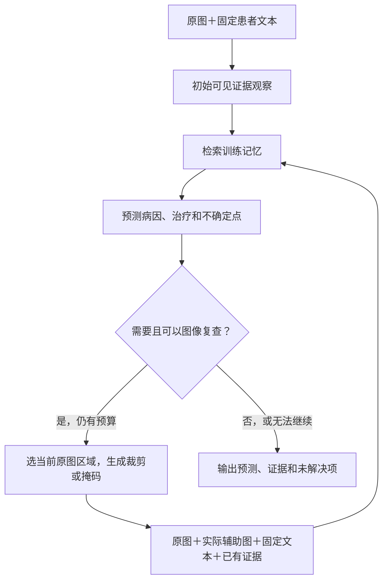

# 图片与文本的离线训练、测试

当前任务是：给定病例原图和允许的患者文本，预测病因与治疗方案；如果存在可用图像复查的不确定点，再看原图及一个裁剪/遮挡片段，更新判断。患者交流、患者画像、模拟患者、医生复核网页和旧 Node/SDK 批处理均已移除。

## 固定输入与隐藏标签

| 项目 | history 模式 | clinical 模式 |
| --- | --- | --- |
| 原图 | 本病例全部原图 | 本病例全部原图 |
| 既往史 | 输入 | 输入 |
| 分布、质地、色调、均一性 | 不从表格输入，可从图片形成视觉观察 | 输入 |
| 病因（含该单元格内的专业分级） | 隐藏标签 | 隐藏标签 |
| 治疗方案 | 隐藏标签 | 隐藏标签 |
| 边界及其他列 | 不输入 | 不输入 |
| 编号 | 只作图片/病例映射 | 只作图片/病例映射 |

表头括号中的说明不会成为新的字段。输入使用白名单，不采用“除最后一列外整行输入”。推理函数会拒绝带 `labels` 或错误文本字段的病例对象。整个病例循环中患者文本固定，不能通过后续轮次补入隐藏列。

当前表格中有 53 个病因和治疗均有标注的病例；默认 seed=42，42 个训练、11 个测试。只有编号或缺标签的行记录在 `split.json` 的排除清单中。`44-1.JPG` 和 `44-2.JPG` 同属一个病例；相同图像的病例分在同一个集合，缺图、重复编号等数据问题直接报错。

## 单病例循环



1. 首次观察只看本病例原图和允许文本，记录可见表征与图像质量，不提前读取标签。
2. 视觉参考检索只按既往史；诊断检索使用允许的临床描述、已取得的图像表征和既往史。两者复用原病例库/检索代码。历史训练病例的标签是参考记忆，当前病例及同图病例不会被检索。
3. 推理输出 `etiology`、`treatment`、可见证据、具体不确定点、置信度和下一动作。模型同时给已提供病例临时相关性分，用于后续轮次结合衰退分调整顺序。
4. 动作只允许 `finish`、`crop`、`mask`。有具体不确定点和区域依据才能请求图像操作。区域必须属于当前原图，坐标为 0..1000 的 `[x1,y1,x2,y2]`。不能复制历史病例坐标，也不能对之前的裁剪图继续裁剪。
5. 下一轮始终保留全部当前原图，并补充最新的一张实际辅助图；裁剪检查细节，掩码探查对某区域的依赖。遮挡变化不是独立阳性证据，不能猜测遮住的内容。
6. 无未解决项且置信度达到阈值才标记 `resolved`。模型决定无法继续、轮数用完、重复同一操作区域或连续没有新视觉证据时停止，保留预测和不确定项，不假装已经确定，也不转回患者问询。置信度是模型自报值，不代表校准后的临床可靠性。

默认最多 4 轮诊断推理，另有一次初始观察；训练中实际使用历史区域时还有一次独立视觉价值审查。每个派生图来自未修改的原图副本，尺寸和实际像素框写入记录。原始 `data/pic/` 文件不修改。

## 训练与测试

`train.py` 按固定顺序执行训练病例，每例必须先完整推理并保存轨迹，随后才读取该例病因和治疗标签，写入监督病例记忆。训练包括未解决的病例，以便后续病例参考已有标注；真实疗效未知，不标记临床治疗成功。当前病例不会在自身推理中检索到自己。

视觉记忆价值由独立模型调用直接检查初始观察与区域判断，只评价实际指导过当前区域操作的历史病例，不使用真实病因/治疗或最终预测是否匹配来评价。确定没有帮助时复用原机制扣减 0.1；不确定保持中性；不删除记忆，且同一病例的同一版本不会重复扣分。

每例训练在上一份快照的副本中运行。成功后生成独立 SQLite 快照，并原子切换 `memory/current.json`；失败停止，不部分提交。相同命令可恢复，完成病例不会重复调用模型。

`test.py` 打开训练快照的 SQLite 只读连接，不写标签、不更新分数或曝光计数、不调用监督写回。每个测试病例读取同一快照，前一例的证据与状态不会传给下一例。测试记录快照指纹并检查文件未变化。两种文本模式独立训练 memory，使用相同病例划分。

## 安装与运行

只需要 Python 3.10+ 及两个 Python 依赖，不需要 pnpm、Node、前后端服务。模型接口本身需提前可用，例如远程 VLM API 或已有 vLLM 服务；本项目不会启动模型服务。

```sh
python -m pip install -r integrations/oral-memory/requirements.txt
```

复制 `.env.oral.example` 为 `.env.oral`：

```dotenv
ORAL_MODEL_BASE_URL=http://127.0.0.1:8000/v1
ORAL_MODEL_NAME=Qwen3-VL-8B-Instruct
ORAL_MODEL_API_KEY=your-key
```

无鉴权本地接口可留空 key；模型需支持图像输入和 JSON 输出。请求直接使用 OpenAI 兼容 `/chat/completions`，不需要工具调用能力。

```sh
python train.py --input-mode history --dry-run
python train.py --input-mode history
python test.py --input-mode history
python train.py --input-mode clinical
python test.py --input-mode clinical
```

常用参数：`--max-rounds 4`、`--confidence-threshold 0.75`、`--top-k 5`、`--seed 42`、`--test-ratio 0.2`、`--limit 2`、`--output runs/vision`。`--dry-run` 只检查数据和写划分，不调用模型。`--limit` 的结果标记 `partial`，不冒充全量实验。数据、模型、模式或流程配置改变，使用新的输出目录。

## 输出与指标

默认 `runs/vision/` 已被 Git 忽略。该目录含病例文本、图像副本、标签及模型输出，应作为研究数据管理。

| 路径 | 内容 |
| --- | --- |
| split.json | 固定划分、数据指纹、排除清单 |
| history/config.json、clinical/config.json | 各模式的配置 |
| 模式/memory/current.json | 已提交训练记忆指针 |
| 模式/train或test/case-ID.json | 两项预测、两项标签、指标和未解决项 |
| 模式/train或test/case-ID-随机后缀/episode.json | 初始观察、逐轮输入辅助图、区域、推理结果和视觉价值审查 |
| 同一病例目录/original-N.png、view-N-crop或mask.png | 实际使用的原图副本和辅助图 |
| 同一病例目录/failure.json | 失败说明，已有已提交 memory 不受影响 |
| 模式/train或test/summary.json | 样本量、部分运行标记和汇总指标 |
| 模式/test/frozen.json | 固定训练快照和指纹 |

指标包括病因类别匹配、病因完整文本匹配、治疗组成项匹配/F1、未解决率和平均轮数。所有病例进入分母。类别匹配不是专业分级预测的替代指标，治疗同义词不自动等同；这些是参考标注一致性，不是临床正确率或真实疗效。
