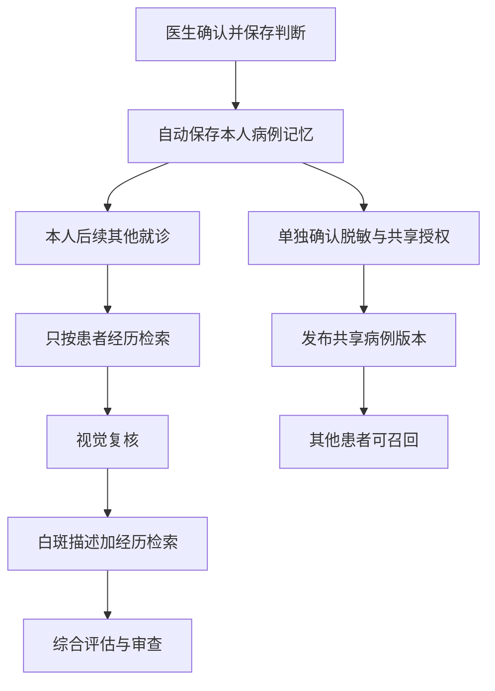

# MedDental 功能机制与业务流程

本版本由患者交流 Agent 根据新增信息和已检索病例控制流程。系统包含五种角色，围绕两阶段检索工作；记忆的第一阶段价值和第二阶段价值独立更新。以下为当前实现说明。

## 一 五个角色分别负责什么

### 患者交流 Agent

患者交流 Agent 整理患者原话、经历和图片，区分患者陈述、模型观察与医生确认。它对照检索病例，判断当前缺少哪些会影响比较和评估的信息，说明追问依据，每次只问一个主要问题。历史病例中的事实不能直接填成患者事实。

它也是流程控制者：接收新增信息后，在检索检查点决定追问、继续视觉、补充检索、执行推理或转人工；审查角色提供修订意见，患者交流 Agent 决定下一步可执行动作。已知、否认、暂缓和冲突均保留，避免重复提问。无候选时可先补充患者经历。普通文字问询可以保存病例引用与待回答问题；图像协作中的控制决定也持久化。

### 检索 Agent

检索 Agent 比较系统召回的候选与当前证据，逐例给出本轮相关性分。视觉前只按患者经历评价；视觉后才加入白斑描述。它不决定长期价值，也不自行修改病例。

### 视觉 Agent

视觉 Agent 先独立观察当前原图，形成不含历史参考的基线；之后才读取历史病例，在当前图像重新定位。系统产生裁剪图和单区域掩码图，局部复核后汇总。明确观察需由原图或裁剪图支持，掩码变化不能独立证明阳性表现。

历史病例提供区域线索时，记录病例版本、当前定位、衍生视图和新增观察的关联。相对基线的新观察保留各区域视觉 Agent 的独立判断与贡献来源，交审查 Agent 核对；区域视觉 Agent 不自行修改价值分。

### 综合推理 Agent

综合推理 Agent 将患者事实、视觉观察、最终参考病例和医生经验组织成候选评估，给出支持、反对、缺失信息与下一步，并说明病例的适用差异。

### 审查 Agent

审查 Agent 直接阅读每个区域视觉 Agent 的判断，对照独立基线与裁剪证据，判定病例区域是否带来新信息并更新第一阶段价值，无需医生逐区域反馈。它也核查综合评估的证据来源、图像一致性、病例可迁移性与过度推断，并提出返工建议。它也可提出纠错经验草稿。患者交流 Agent 可要求针对性返工，但不能绕过未通过审查而结束。内部最多两轮修订，超出预算交人工。审查通过仅表示等待医生，不等于评估成功。

所有角色每次调用均附当前原图与原始问题。医生通过独立工作台复核，不计入五种模型角色。

## 二 整体业务流程

### 第一阶段 用患者经历寻找视觉参考

1. 保存患者原话和本轮事实，统一口腔经历与诊疗经历。
2. 只按患者经历，从个人历史和已授权共享来源召回候选；不使用白斑外观替代经历，当前就诊记录不作为自己的历史参考。
3. 检索 Agent 对所有候选给出临时模型相关性分 M。系统乘第一阶段价值 D_visual，得到 F_visual，再选择参考。
4. 患者交流 Agent 对照已检索病例判断信息缺口。如果需要关键事实，保存一个带病例依据的问题并等待回答；否则进入视觉。
5. 视觉 Agent 先仅看当前原图和患者经历，形成不可改写的独立观察基线。该调用不接收历史病例、衍生图、其他角色的视觉结论。
6. 再读取参考病例，在当前图像定位，产生裁剪与单区域掩码视图。各局部调用保留当前原图，不读取同批其他局部结论，最后汇总。
7. 输出核实后的白斑描述，以及哪些新增观察可能来自哪条历史病例的区域线索。

### 第二阶段 用白斑描述加患者经历寻找评估参考

1. 使用核实后的白斑描述与统一患者经历重新召回；初排优先白斑相关性，再看经历相关性。
2. 将前轮候选与新召回病例合并、去重，保留最新有效版本，不仅保留前轮 Top-K。
3. 对整个合并集合重新给本轮相关性分 M，乘第二阶段价值 D_diagnosis，得到 F_diagnosis。不能平均、累加或沿用前轮模型分。
4. 患者交流 Agent 决定继续推理、追问、视觉复核或补充检索。后两种操作仅重做相关环节，再更新综合评估。
5. 综合推理与审查完成后，由患者交流 Agent 判断下一动作。审查通过后才能交医生；仍有问题则返工、问询或转人工。
6. 医生核对并保存判断后，系统自动把当前病例保存为本人病例记忆，关联患者经历、白斑描述、原图、视觉区域及医生意见与判断；供后续就诊的两阶段检索使用。患者陈述和模型观察保留来源，不自动变成医生确认的病理事实。
7. 本轮结束前，审查 Agent 直接读取全部已使用区域的视觉判断，完成第一阶段价值审查。医生只确认本次评估成功与否，用于第二阶段价值；未知结果保持未知，不自动当成失败。

### 避免参考病例高度重复

系统先保留最终分最高的病例。之后对表征、经历和结果文本做词元重合比较，近似重复病例不重复占用名额；在当前最佳剩余最终分的 90% 范围内，优先补充与已选病例不同的证据。最后仍保留原始分数与筛选记录。

默认最多选择五个正分参考，允许因重复而少于五个，不强行凑数。未选病例保留在候选记录与记忆库，不能因为重复筛选而扣分。该筛选是可解释的词元基线，不宣称完成临床语义去重。

## 三 记忆库轮转

### 保存内容

- 白斑表征：位置、颜色、形态、表面、范围、有来源的病理结果和版本化图像关联。
- 患者经历：口腔经历与诊疗经历统一管理，保留事件子类型和旧存储引用。
- 医生反馈：纠正、补充、追问和确认结果。
- 已确认纠错经验：适用条件、原先错误、纠正动作、作用环节、适用边界与来源。这是从医生反馈整理出的经验，不替代原始记录。

### 医生判断后的病例自动入库

医生在五角色评估的复核入口确认并保存判断后，系统在同一事务内保存医生意见和当前病例记忆。无需再点击共享发布，病例便可在本人后续就诊时被检索。即使本次评估失败或效果尚未判定，病例仍入库；是否入库与是否成功分别处理。

病例记忆包含可检索的表征摘要、患者经历、医生判断和私有图像关联。患者经历仍标为患者陈述，视觉观察保留模型来源与未审核状态；医生结论作为已确认诊疗记录保存，不从照片或自由文本猜测结构化病理。原始问题、各角色输出和医生复核保留在来源评估记录中。一个就诊保持稳定的病例标识，新一轮医生复核按版本更新；补充未知结局时更新关联诊疗记录并保留旧版，普通重试不重复入库。

这些记录进入现有统一检索引擎：第一阶段只使用患者经历，第二阶段使用白斑描述加患者经历。当前就诊仍排除自身记录，供后续其他就诊参考；自动入库不会给当前病例自我加分，也不会改动参考病例的阶段价值。跨患者复用仍需单独复核、脱敏与授权发布，私有原图不会自动共享。

医生填写补充、追问或纠正意见仍可单独保存。纠正使旧评估失效，需要患者端再次发起评估；下次保存医生判断时更新病例记忆。自动保存病例不等于自动重新运行五角色评估。

### 两阶段价值独立更新

本轮临时模型相关性分范围为 0 至 100；长期价值分初始为 1。系统分别计算：

- 第一阶段最终分 = 本轮经历相关性分 × D_visual。
- 第二阶段最终分 = 本轮综合相关性分 × D_diagnosis。

第一阶段是否有效，只看病例的掩码位置线索是否带来了基线之外、由当前原图或裁剪支持的新信息。系统保留每个区域视觉 Agent 的独立判断、调用步骤、裁剪与掩码引用，再由审查 Agent 逐项核对。审查不是只看汇总摘要，也不依赖医生反馈。没有区域线索、没有实际测试的掩码、没有有效新证据时，不能给出正向新增信息评价。审查 Agent 需要区分“有新增信息”“无新增信息”和“无法确定”，并核对所有已使用区域。正向判断必须引用对应区域调用步骤和裁剪支持的新增观察；证据不足或无法排除同义改写时保持无法确定，不扣分。

第二阶段只按医生确认本次评估是否成功评价。医生保存成功或失败结果后，可对本轮第二阶段所选参考应用该结果；医生页面会执行这一操作。审查通过或医生确认已看过，不自动等于成功。尚未判定时不计分。

审查确认有新增信息时保留视觉价值，明确无新增信息时降低视觉价值 0.1；医生确认评估成功时保留诊断价值，失败时降低诊断价值 0.1，默认最低为 0。未使用、未检索到、临时相关性低或没有结局，不自动扣分。同一轮同一记忆版本同一阶段只接受一次评价，重试不重复扣分，两阶段互不串分。

旧数据库升级时，两个阶段各一次性继承原迭代分，保留旧记录与反馈；此后分别更新。旧兼容接口保留旧分统计，不再暗中修改已初始化的阶段分。新临床记录版本从 1 开始；普通视觉补充不重置价值。没有独立基线或区域独立判断的旧运行不能回填视觉价值评价。视觉价值审查在本轮结束前自动保存；同一病例版本本轮只计一次，重复提交不重复扣分。医生工作台只读展示视觉审查结果，不提供第一阶段手工计分按钮。

### 医生纠错如何成为下一轮经验

审查可提出经验草稿，医生也可直接填写。草稿不进入可用经验检索；医生核对适用条件、纠正动作和边界并确认后，系统保存为版本化经验。后续按当前患者原始信息与经验适用条件匹配，将相关经验提供给患者交流、推理和审查。

默认经验仅用于当前患者。跨患者复用需医生单独确认脱敏与授权；共享经验不携带原始患者标识或私有运行引用。未经授权的患者记录和图片不会自动共享。医生实质纠正仍写回原医生记忆，经验不能取代原始证据。

### 完整循环

患者输入与视觉观察先保存来源记录；医生确认判断后，当前病例自动作为本人病例记忆入库；病例在后续其他就诊中被检索；患者交流 Agent 根据病例选择追问和流程；审查 Agent 核对各区域视觉判断并更新视觉价值，医生确认任务结果后更新诊断价值；两个阶段各更新自己的价值；医生纠错经确认形成经验；下一轮同时利用更新后的病例、阶段价值与经验。记录不自动删除。

## 验证与使用

启动仍使用 `pnpm oral:patient` 和 `pnpm oral:doctor`。医疗部署默认开启病例驱动问询，旧独立 MCP 部署可保留原问卷兼容模式。

运行 `pnpm test:oral` 检查存储、问询、阶段分、医生 HTTP/DOM 与真实 Harness 流程；`pnpm test:framework` 检查保留框架。测试使用合成病例与模拟外部模型，真实医学效果尚需评估。基线仍为结构化字段及词元匹配，未加入模型训练。
