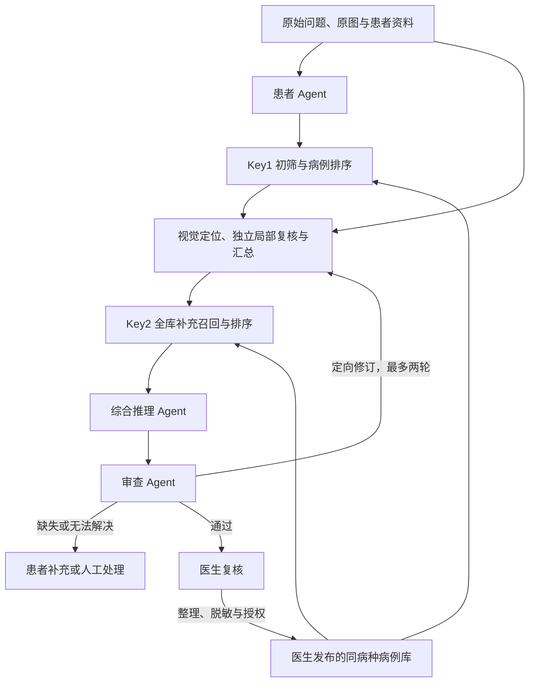

# 基于病例经验的多模态医疗协作

本次实现以“冻结模型、增长病例经验”为核心。在既有 Harness AgentLoop、附件、子智能体、工具与 Web 入口上运行五类角色，不引入另一套模型调度器，不训练模型。默认病种仍为口腔白斑；新病种通过画像配置隔离病例库。

## 实际执行流程

1. 患者在原有 Web 对话中提交问题、口内照片和补充资料。患者端宿主绑定患者及就诊身份；工具不能自行切换身份。
2. 父 Agent 调用 `medical_consult`。工具从会话的原始 `user/message` 读取问题和图片，校验附件，再保存不可变输入。不能用模型编写的摘要代替原文。
3. **患者 Agent** 根据原文、原图、既有问询字段及医生意见整理已知表征、病史、缺失、一个下一问题和风险线索。否认与未提供必须分开。
4. **Key1 初筛**用表征与病史在同病种共享病例库中召回。**检索 Agent**比较适用性、支持与矛盾，给出本轮相关性及可迁移经验。
5. **视觉 Agent**读取当前原图及推荐病例的原图、区域语义和病例差异，在当前图中重新提出区域。历史病例坐标仅用于解释历史证据，不能直接复制为当前坐标。
6. 程序按当前区域生成裁剪图和遮挡图：每张遮挡副本只遮一个区域，当前原图始终保留。每个区域由独立视觉子调用复核，其输入是所有当前原图、原始问题和该区域的一组 crop/mask，不读取同批其他局部结论。之后视觉汇总调用读取全部局部结果，消除冲突。
7. **Key2 补充召回**将原图或 crop 支持的清晰视觉观察并入表征查询，重新搜索整个同病种病例库。因此可以发现 Key1 没有召回的新病例，而不只是重排旧列表。mask 单独产生的变化不能加入阳性视觉证据。
8. 检索 Agent 进行第二轮适用性排序。**综合推理 Agent**输出鉴别假设、证据引用、反证、缺失、下一步和不确定性。
9. **审查 Agent**独立检查。患者缺失返回 `needs_input`；视觉、检索、推理问题可定向修订，最多两轮；仍未解决转 `needs_human`。通过后状态是 `awaiting_doctor`。
10. 医生在工作台核对原图和结果，确认本轮临床意见。可另行整理并发布获得授权的脱敏病例，或对本轮已提供的参考病例给出效用反馈。

五类角色都是实际的 Harness spawn 激活，均以 `delivery: caller` 等待结构化输出并释放激活资源。每一次角色调用都附上原始问题和所有当前原图，不仅传图片 ID 或上游总结。所有角色显式使用父 Agent 当前选定的同一个图像模型；模型未声明 image 输入时直接拒绝执行，不退化为纯文字推断。角色子预设屏蔽继承的全局工具，只保留运行时的结构化结果提交工具。



## 三层记忆与图像

| 层 | 保存内容 | 跨患者读取 |
| --- | --- | --- |
| 原有四类个人记忆 | lesion、experience、care、doctor；保留原有问询与分级检索 | 不允许 |
| 私有多模态就诊 | 原始问题、逐轮原文、原图、区域、crop/mask 变换、角色输出、检索回执、医生意见、输入版本 | 不允许 |
| 共享病例经验 | 医生重新整理的表征、相关病史、确认依据、可迁移经验、误判陷阱、结果、授权来源、脱敏原图和历史区域 | 仅同病种、已发布病例 |

私有数据库新增 `medical_cases`、`medical_runs`、`medical_events`、`medical_session_bindings`，原有四类记忆不改成共享表。共享库是独立 SQLite 文件，含 `cases`、不可变 `case_versions` 和 `deliveries`。图片位于独立文件目录，数据库保存索引和元数据。私有图片按患者散列隔离；共享图片使用新的不透明 ID。公开病例不自动复制原始问题、患者标识或就诊编号。

输入图片做格式验证、EXIF 方向归一化与元数据清理，保存 PNG；不会修改 Harness 的已存附件。医生发布时仍须检查画面中的身份标识；医生可在原图下方指定身份信息遮挡框（`redactions`），按归一化框对发布副本做黑色遮挡，私有原图保持不变。没有宣称系统能自动完成临床脱敏。当前图片接口要求医生令牌，或持有当前患者的已送达病例回执，不提供任意路径读取。

`MEDICAL_SHARED_DB` 和 `MEDICAL_ASSET_ROOT` 必须在所有患者宿主中指向同一套部署位置。每个患者的 Harness home 仍隔离。不同患者即使在同一私有数据库中，也通过宿主身份过滤读取。

## 可追溯证据与版本

- 原图元数据记录上传它的原始消息 ID，重复上传保留各个来源；共享病例不复制这些私有消息 ID。
- 每项视觉观察绑定当前 `image_id`、`supporting_views`、明确程度和标签。视图记录归一化 box、像素 box、原图 ID、操作类别及定位依据。
- 模型不能引用未送达的病例 ID/版本、其他患者图像或不存在的视觉观察。mask-only 观察不能被标成清晰阳性。
- 综合评估引用最终视觉观察 ID；`patient` 表示患者陈述这一类来源。当前版本尚未做到每条病史的细粒度句级引用，应在后续研究中细化。
- 输入保存使用 event ID 去重与 revision 比较；原始消息不能被同 ID 改写。患者补充信息、团队医生纠正，或原有问询状态变化，都会让旧角色输出失效。
- 后续轮次可读取同一患者最近十条已签署的医生复核意见，跨患者不可见；完整旧轮次仍保留在私有库。
- 每轮保存输入快照，医生查看历史轮次时使用当轮图片。一个 Harness 会话不能迁移到另一个就诊编号；更换就诊请新建会话。
- 角色失败、取消、格式错误及资源超限不会被写成成功诊断；已保存的部分记录可供排查。中断后发送新消息开始新轮次，不自动重放不完整推理。

## 两种评分

**本轮相关性**由检索 Agent 输出 `relevance: 0..100`、支持、矛盾与理由。它回答“这例是否适用于当前患者”，不修改长期分数。推荐病例的图像才优先进入后续角色上下文。

**长期效用**只依据医生确认的真实反馈更新：

\[
U=(n_{helpful}+1)/(n_{helpful}+n_{not\_helpful}+2).
\]

新病例先验为 0.5。曝光只记曝光，不加分；模型采用不等于成功。医生复核后，同一轮、同一病例版本只计一个结果；重复相同反馈幂等，不同反馈冲突拒绝。至少三次无效反馈且 U<0.3 时进入低频，不删除；新病例版本重置当前统计，旧版本保留。

当前初筛是可复现的中英文词元/中文双字覆盖匹配。排序先按表征相关性的 0.1 区间，再按病史相关性，效用与低频因子只在相近表征内参与排序。低频匹配病例有一个可复现的轮换探索名额。它不是经临床验证的相似度标定，也没有实现图像向量近邻检索；图像比较由冻结的多模态 Agent 完成。以后可以替换候选索引，不需要改变五角色协议。

## 扩展病种

`profiles/diseases.json` 包含默认 `oral-leukoplakia` 和 `general-medical` 示例。增加病种画像，配置名称、表征字段、病史字段、视觉可判断范围和风险线索；再设置 `MEDICAL_DOMAIN`。也可用 `MEDICAL_PROFILES` 指定独立配置文件。同一次就诊不能改变病种，共享病例只能在同病种中检索。

画像控制新团队的输入约束和任务描述，不等于已经建立该病种的临床知识库。原有 `patient_turn` 问卷与四类口腔记录仍是口腔专用入口；扩展其他专科时应配套专科问询模板、医生确认的病例和独立评估。

## 启动与使用

```sh
pnpm install --frozen-lockfile
python3 -m pip install -r integrations/oral-memory/requirements.txt
cp .env.oral.example .env.oral
# 编辑患者、就诊、医生凭据、数据库与图片目录，并配置图像模型。
pnpm build
pnpm oral:patient
# 第二个终端：
pnpm oral:doctor
```

如果 Python 使用虚拟环境，将 `ORAL_MEMORY_PYTHON` 指向其解释器。五个角色继承在 Harness 中选择的图像模型，不增加专用模型 API Key 配置。默认 DeepSeek 文字模型不能运行图片评估，必须切换到已声明图像能力的提供方/模型。

患者上传问题与图片后可明确要求“运行五角色病例评估”。医生打开本地工作台，填写令牌与就诊编号，选择“读取团队评估”；查看原图、遮挡视图和各角色结果，再保存医生复核。发布前整理无身份信息的病例字段，确认图片脱敏与复用授权；已有病例更新需填写准确共享版本。效用反馈在本轮医生复核完成后提交。

资源上限：每就诊 3 张原图、30 条原文、48,000 字符原始文本；单图归一化后不超过 8 MiB；每轮最多 24 次角色输出、6 次检索、12 张衍生图；每角色 180 秒、整个工具 20 分钟。候选索引最多扫描同病种 10,000 例，超过时明确要求升级索引。上下文和附件还受模型/宿主预算限制，超限明确失败，不静默删除原图或原问题。

## 文件入口与验证

| 文件 | 职责 |
| --- | --- |
| `harness-team.mjs` | 父工具、五角色调用、原图传递、局部复核、定向审查循环 |
| `harness-role.mjs` | 子角色的继承工具隔离 |
| `medical_bridge.py` | 有界 JSON 子进程接口，仅执行存储/检索/视图操作 |
| `team_memory.py` | 私有状态、共享病例、原图/视图、版本、医生发布及效用反馈 |
| `team_schemas.py`、`team-contracts.json` | Python 校验与 Harness 结构化输出协议；测试检查二者一致 |
| `doctor_portal.py`、`web/medical.js` | 医生图像预览、复核、纠正、发布、效用反馈 |
| `tests/test_team.py` | 隔离、版本、召回、图像几何、评分、医生权限 |
| `tests/harness-team.spec.ts` | 真实 Loader/预设/AgentLoop/spawn/附件链路，仅模拟外部模型 |

执行 `pnpm test:oral` 运行原有回归与新团队检查；`pnpm test:medical-web` 检查实际患者 Web 启动。测试中的病例与图像均为合成数据。工程链路通过不代表诊断效果已被验证，当前没有用真实患者数据或真实模型进行临床验证。
